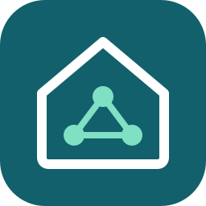

<p align="center">
  
</p>

# Home Assistant Integration for Wiser for KNX (Local API)

[](https://github.com/hacs/default)
[](https://opensource.org/licenses/MIT)

A Home Assistant custom integration for **Schneider Electric Wiser for KNX** (and compatible **spaceLYnk** / **LogicMachine** controllers) using their local API.

---

## ✨ Features

- **Automatic Discovery on LAN**:
  - **mDNS / Zeroconf**: Automatically identifies controllers broadcasting `_http._tcp.local.` (matching `wiser*`, `spacelynk*`, `logicmachine*`) or `_knx._udp.local.`.
  - **DHCP Snooping**: Automatically detects Schneider Electric & Embedded Systems hardware by MAC address prefix (`00:0C:C6`, `00:00:54`, `E0:4F:43`).
- **Dynamic API Endpoint Parsing**:
  - Automatically probes and identifies the active local API type:
    - **OpenAPI / Swagger REST API** (`/api/openapi.json`, `/api/v1/objects`)
    - **SCADA Remote JSON API** (`/scada-remote/request`)
    - **Services JSON API** (`/services/json/`)
- **Seamless Credential Handling**:
  - Prompts for credentials (HTTP Basic Auth / API credentials) directly within the Home Assistant UI during configuration.
- **Controller backups (main focus)**: Create password-protected backups of the controller's system and project configuration from Home Assistant, set up during the initial connection. Run them on demand (button or `wiser_for_knx.create_backup` service), on a schedule, and automatically before every Home Assistant backup, with automatic retention. See [Controller Backups](#-controller-backups).
- **Light and switch import**: Only lights and switches are imported as devices, so you can control them from Home Assistant:
  - **Lights** (`light`): on/off lights and dimmers.
  - **Switches** (`switch`): relay switches, sockets and binary actuators.
  - **Touch configuration requirement:** the controller only publishes a widget channel through its API when the channel has **both** a switch/value object **and** a status feedback object (they may use the same group address). Channels with only one of them are not imported, even if the Touch widget marks the status feedback as optional.
  - Devices are classified from the KNX function type (and Touch widget metadata when available). Sensors, covers, thermostats, alarms and scenes are intentionally not imported.

---

## 🚀 Installation

### Option 1: Via HACS (Recommended)

1. Open **HACS** in your Home Assistant instance.
2. Click the three dots in the top right corner and choose **Custom repositories**.
3. Paste the URL of this repository:
   ```
   https://github.com/bartosekpetr/HomelYnk-HA
   ```
4. Category: **Integration**.
5. Click **Add**, find **Wiser for KNX**, and click **Download**.
6. Restart Home Assistant.

### Option 2: Manual Installation

1. Copy the `custom_components/wiser_for_knx` folder from this repository into your Home Assistant's `config/custom_components/` directory:
   ```text
   config/
   └── custom_components/
       └── wiser_for_knx/
           ├── __init__.py
           ├── manifest.json
           ├── config_flow.py
           ├── const.py
           ├── api.py
           ├── coordinator.py
           ├── entity.py
           ├── light.py
           ├── switch.py
           ├── sensor.py
           ├── backup.py
           ├── backup_utils.py
           ├── button.py
           ├── services.yaml
           ├── widgets.py
           ├── strings.json
           └── translations/
               └── en.json
   ```
2. Restart Home Assistant.

---

## ⚙️ Configuration

1. In Home Assistant, go to **Settings** -> **Devices & Services**.
2. If your Wiser for KNX is powered on and connected to the same LAN, Home Assistant will show a **"Discovered"** notification card.
3. Click **Configure**, enter your **Username** (default: `admin`) and **Password**, and click **Submit**.
   A second step then asks for the backup settings (see [Controller Backups](#-controller-backups)); you can skip it by leaving the backup password empty.
4. If auto-discovery is not enabled on your network:
   - Click **Add Integration** in the bottom right corner.
   - Search for **Wiser for KNX**.
   - Enter your controller's IP address and credentials.
5. **Verify SSL certificate** is off by default because controllers typically use self-signed certificates. Enable it if your controller has a trusted certificate; otherwise credentials can be intercepted by someone on your local network.

---

## 💾 Controller Backups

The integration can download your controller's configuration through its management API (`/api/management/v1`) using the same credentials. Two ZIP archives are stored per backup: the **system** configuration and the **project** (SCADA) configuration. Both are encrypted with a password you choose.

**Setup:** the backup settings are asked right after the connection is verified when you add the controller, together with an option to **create a backup right away**. You can change them at any time: go to **Settings → Devices & services → Wiser for KNX** and click **Configure** (or the gear icon on the integration entry). Set:

- **Backup password**: at least 8 characters with an uppercase letter, a lowercase letter and a digit (the controller enforces this). Leave it empty to skip backups for now (or, later in Configure, to keep the current one).
- **Automatic backup interval (hours)**: default 24; `0` disables scheduled backups.
- **Number of backups to keep**: older backups are deleted per type (default 7).

**Use it:**

- Press the **Create backup** button on the controller device, or call the `wiser_for_knx.create_backup` service (for example from an automation).
- **Controller health** diagnostic sensors (refreshed every 5 minutes): firmware version, uptime, CPU load (1 min), memory used %, storage used %. The firmware and hardware version are also shown on the controller device. If the management API is unreachable these sensors just become unavailable.
- The **Last backup** diagnostic sensor shows when the last backup succeeded, and the last error if one failed.
- Files are written to `wiser_backups/` inside your Home Assistant configuration folder, named `wiser_<host>_<system|project>_<timestamp>.zip`.

**Included in Home Assistant backups:** the `wiser_backups/` folder is inside `/config`, so every Home Assistant backup contains your controller backups. Just before each Home Assistant backup starts, the integration also takes a fresh controller backup (if a backup password is set), so the copy in the HA backup is current. If the controller is unreachable, the HA backup still proceeds and a warning is logged.

**Notes:**

- Keep the backup password safe. It is stored in the Home Assistant config entry and is needed to restore a backup in the Wiser for KNX web interface. This integration does not restore backups.
- The backups contain your whole configuration. Treat the folder as sensitive and include it in your own offsite backups.

---

## 📄 License

This project is licensed under the [MIT License](LICENSE).

## 🤝 Contributing / AI agents

See [AGENTS.md](AGENTS.md) for the project overview, architecture and working rules, [docs/controller-api.md](docs/controller-api.md) for the controller APIs, and [docs/development.md](docs/development.md) for tests, tools and the release process.

## ⚖️ Disclaimer

This is an unofficial, community project. It is not affiliated with, endorsed by, or sponsored by Schneider Electric or the KNX Association. "Wiser", "Schneider Electric" and "KNX" are trademarks of their respective owners and are used only to describe compatibility. The icon is an original design and is not a Schneider Electric or KNX logo.
