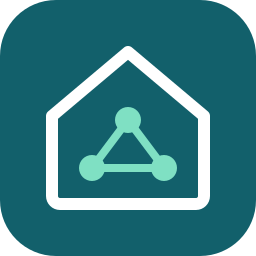

<p align="center">
  
</p>

# Home Assistant Integration for Wiser for KNX (Local API)

[](https://my.home-assistant.io/redirect/marketplace_repository/?owner=bartosekpetr&repository=HomelYnk-HA&category=integration)
[](https://opensource.org/licenses/MIT)

A Home Assistant custom integration for **Schneider Electric Wiser for KNX** (and compatible **spaceLYnk** / **LogicMachine** controllers) using their local API.

---

## ✨ Features

- **Automatic Discovery on LAN**:
  - **mDNS / Zeroconf**: Automatically identifies controllers broadcasting `_http._tcp.local.` (matching `wiser*`, `spacelynk*`, `logicmachine*`) or `_knx._udp.local.`.
  - **DHCP Snooping**: Automatically detects Schneider Electric & Embedded Systems hardware by MAC address prefix (`00:0C:C6`, `00:00:54`, `E0:4F:43`).
- **Dynamic API Endpoint Parsing**:
  - Automatically probes and identifies the active local API type:
    - **OpenAPI / Swagger REST API** (`/api/openapi.json`, `/api/v1/objects`)
    - **SCADA Remote JSON API** (`/scada-remote/request`)
    - **Services JSON API** (`/services/json/`)
- **Seamless Credential Handling**:
  - Prompts for credentials (HTTP Basic Auth / API credentials) directly within the Home Assistant UI during configuration.
- **Controller backups**: Create password-protected backups of the controller's system and project configuration from Home Assistant, set up during the initial connection. Run them on demand (button or `wiser_for_knx.create_backup` service), on a schedule, and automatically before every Home Assistant backup, with automatic retention. See [Controller Backups](#-controller-backups).
- **Everything the controller exports becomes an entity** (since v0.8.0): nothing published through the local API is left invisible.

  | Controller function | Home Assistant |
  |---|---|
  | `switchingLight`, `dimming`, `dimmingDali`, `colorRGB`, `colorRGBW`, `clc` | **light** — on/off, brightness, RGB and RGBW colour |
  | `switching`, `switchingSocket`, `switchingAC`, `switchingFan` | **switch** |
  | `blindsVertical`, `blindsHorizontal`, `shadingRotary`, `blinds` (SOMFY) | **cover** — position, slat tilt, up/down, stop |
  | `temperatureAirFan`, `iTRV`, `genericThermostat`, `VDCThermostat`, `temperatureFloor`, `se8000`, `airzone`, the Danfoss and Logic thermostats | **climate** — current temperature, setpoint, heating/cooling, operation mode as a preset, fan mode |
  | `smartLock` | **lock** |
  | `scene` | **button** per scene number |
  | `alarm*`, `windowDoorSensor`, `movementDetector`, the door variant | **binary_sensor** with a matching device class |
  | `airQuality`, `gasSensor`, `particleSensor`, `weather`, `gauge`, `info`, `power` | **sensor** |
  | any other writable slot | **select** (it publishes a list of values) or **number** |

  Alongside each device: its battery level and low-battery alert, its device-status (online/offline) flag, a socket's active power, a valve drive's heating demand, a shutter's "is moving" and last direction — each as its own entity, diagnostic ones marked as such.
- **A configured gauge is read as what it measures.** A Gauge tile publishes the same anonymous datapoint whatever is wired to it — no unit, no quantity — so by default it becomes a plain sensor showing the published number, with no unit and no graph. If the tile's **Device** setting (in Touch: the widget's settings, *Device*) names the quantity, that is published too, and the sensor now gets it: *humidity* → `%` and a humidity sensor, *CO2* → ppm, *brightness* → lux. Power, energy, voltage, current, frequency and wind speed name a quantity whose unit the API does **not** state — watts or kilowatts, volts or millivolts — so those become a plain number with long-term statistics and no unit, rather than a unit that could be wrong by a factor of 1000. Set the **Minimum**/**Maximum** and **Decimals** on the tile too; without them the controller renders it oddly on its own screens.

  ⚠️ **A temperature gauge cannot be typed this way**: the controller's own Device list has no temperature entry, so a temperature tile publishes exactly what an unconfigured one does and stays a plain sensor. If you want °C, a graph and long-term statistics for it, read that sensor over KNX directly with Home Assistant's own [KNX integration](https://www.home-assistant.io/integrations/knx/), which can be run alongside this one.
- **Instant updates (push)**, on by default: the controller sends each datapoint change to Home Assistant as it happens — sub-second instead of up to ten seconds — and polling drops to a slow safety net. It never stops being a safety net, because the controller gives no sign when it quietly stops sending; see [Instant updates](#-instant-updates-push).
- **New devices appear without a restart**: the controller publishes a function a few seconds (and during heavy reconfiguration, minutes) before its datapoints, so entities are added as soon as they show up instead of only at startup.
- **Controller monitoring**: firmware, uptime, CPU load (1/5/15 min), memory and storage from the management API, the time of the last backup, and how many functions and datapoints the controller is currently exporting.
- **Touch configuration requirement:** the controller only publishes a widget channel through its API when the channel has **both** a control object **and** a status feedback object (they may use the same group address). Channels with only one of them never reach the API, even where the Touch widget marks the status feedback as optional — and a widget whose "Disable API Export" setting is on is absent entirely. The "Exported functions/datapoints" sensors are there to make that visible.
- One Touch widget can become **several** devices: a multi-channel widget publishes one device per fully configured channel, named `<widget name> 1`, `<widget name> 2` and so on, and a widget such as a weather station or a thermostat publishes devices of *different* kinds at once.
- A state is read from the status object and a command is sent to the control object (the controller collapses the two into one datapoint). Home Assistant shows the new state right away; if no actuator reports the status object back, the state reverts on the next read.

---

## 🚀 Installation

### Option 1: Via the Marketplace (Home Assistant 2026.11 and newer)

From 2026.11, Home Assistant includes HACS as the **Marketplace**, so there is no separate HACS to open.

1. Click the badge at the top of this page. It opens this repository in the Marketplace of your own Home Assistant instance.
2. Download **Wiser for KNX**.
3. Restart Home Assistant.

The badge needs [My Home Assistant](https://my.home-assistant.io/) to be set up with your instance's address.

### Option 2: Via HACS (Home Assistant before 2026.11)

1. Open **HACS** in your Home Assistant instance.
2. Click the three dots in the top right corner and choose **Custom repositories**.
3. Paste the URL of this repository:
   ```
   https://github.com/bartosekpetr/HomelYnk-HA
   ```
4. Category: **Integration**.
5. Click **Add**, find **Wiser for KNX**, and click **Download**.
6. Restart Home Assistant.

[](https://my.home-assistant.io/redirect/hacs_repository/?owner=bartosekpetr&repository=HomelYnk-HA&category=integration)

The `hacs_repository` link above takes the same parameters and works on both sides of 2026.11.

### Option 3: Manual Installation

1. Copy the `custom_components/wiser_for_knx` folder from this repository into your Home Assistant's `config/custom_components/` directory:
   ```text
   config/
   └── custom_components/
       └── wiser_for_knx/
           ├── __init__.py
           ├── manifest.json
           ├── config_flow.py
           ├── const.py
           ├── api.py
           ├── coordinator.py
           ├── entity.py
           ├── light.py
           ├── switch.py
           ├── sensor.py
           ├── backup.py
           ├── backup_utils.py
           ├── button.py
           ├── services.yaml
           ├── widgets.py
           ├── strings.json
           └── translations/
               └── en.json
   ```
2. Restart Home Assistant.

---

## ⚙️ Configuration

1. In Home Assistant, go to **Settings** -> **Devices & Services**.
2. If your Wiser for KNX is powered on and connected to the same LAN, Home Assistant will show a **"Discovered"** notification card.
3. Click **Configure**, enter your **Username** (default: `admin`) and **Password**, and click **Submit**.
   A second step then asks for the backup settings (see [Controller Backups](#-controller-backups)); you can skip it by leaving the backup password empty.
4. If auto-discovery is not enabled on your network:
   - Click **Add Integration** in the bottom right corner.
   - Search for **Wiser for KNX**.
   - Enter your controller's IP address and credentials.
5. **Verify SSL certificate** is on by default. Controllers typically use a self-signed certificate, so setup shows you the certificate's SHA-256 fingerprint to confirm once — see [TLS certificate verification](#tls-certificate-verification) below. Existing installations keep whatever setting they already had.

---

## TLS certificate verification

The controller's certificate is verified by default. Controllers usually use a self-signed certificate, so when verification fails during setup the integration shows the certificate's SHA-256 fingerprint. Compare it with the controller, then confirm; only that exact certificate is trusted from then on. If the certificate later changes, Home Assistant asks you to re-confirm instead of connecting.

**If Home Assistant asks about the certificate on an installation that was already working**, it is telling you that the controller now presents a *different* certificate than the one you confirmed — a reinstalled or regenerated controller certificate is the usual reason. Home Assistant shows a **"Controller certificate changed"** card with the new fingerprint and the one it trusted before: compare the new fingerprint with the controller, then submit the card. That keeps the integration entry, and with it your entity ids, names and history.

**Do not delete the integration and add it again** to get past that card. Entity ids are tied to the config entry, so a fresh entry creates a fresh set of entities — the old history is dropped and names can come back with a `_2` suffix. Removing and re-adding is only worth it if you want a clean slate.

Under **Configure** you can enable *Skip certificate verification (insecure)*. While it is on, Home Assistant shows a repair notice. Entries created by earlier versions keep their existing (unverified) setting after the upgrade and show that notice until you turn the option off.

The connection uses HTTPS by default. *Use plain HTTP instead of HTTPS (insecure)* is available during setup and under **Configure** for controllers that cannot serve HTTPS; while it is on, the controller password and the backup password are sent unencrypted and Home Assistant shows a repair notice.

## ⚡ Instant updates (push)

By default the controller is asked to **send** every datapoint change to Home Assistant instead of
being polled for it. State then arrives in well under a second, and Home Assistant stops
re-downloading every value every few seconds.

Nothing to set up: during startup the integration registers a callback address with the controller
and subscribes to everything the controller exports. You can turn it off under **Configure** →
*Instant updates (push)* to go back to polling only.

**Polling never stops.** It slows to one full read every few minutes while push is working, and it
goes straight back to the interval you configured if push stops. That is deliberate: the
controller's delivery service can stop without any error — the subscription stays registered and
the API keeps answering normally — so Home Assistant checks for itself rather than trusting it.
If a check finds values that were never sent, the integration goes back to full-speed polling and
re-registers the subscription. **Every way push can fail ends in the polling the integration has
always done, never in missing or stale devices.**

The controller device has a **Push** sensor so you can see which is in use:

| Push | What it means |
|---|---|
| `live` | changes are arriving; polling is the slow safety net |
| `pending` | subscribed, but nothing has been delivered yet |
| `degraded` | changes were being missed, so polling is back at full speed and the subscription is being re-registered |
| `failed` | it could not be set up — the `reason` attribute says which step failed |
| `off` | turned off under **Configure** |

This sensor read `unavailable` instead of `failed` in v0.9.0, and that was a mistake: `unavailable`
is also how Home Assistant shows an entity it is not being given a state for, so a push channel
that had simply failed to register looked exactly like a broken sensor — and the `reason` attribute
that would have told the two apart is dropped by Home Assistant for a genuinely unavailable entity.
**If your Push sensor reads `unavailable`, you are on v0.9.0 or older.** Update, and it will say
which of the two it is.

Worth knowing:

- The controller needs to be able to reach Home Assistant's own address. The callback is registered
  against Home Assistant's **internal** URL (**Settings** → **System** → **Network**), so if that
  is wrong or unreachable from the controller, the sensor stays at `pending` and the integration
  just keeps polling.
- The callback is **plain HTTP** unless your Home Assistant serves HTTPS on its internal URL. On a
  normal home network that is the same exposure as the rest of the traffic between the two; every
  message is signed, and a message that fails its signature check is dropped without changing
  anything.
- Very rapid changes to the *same* value are coalesced by the controller: changes less than about a
  second apart arrive as one message carrying the latest value. Home Assistant always shows the
  current value, but it cannot be used to count individual pulses.
- **A controller restart needs nothing from you.** Measured on a reference unit: the subscription
  survives a restart and messages start arriving again on their own, about 40 seconds after it is
  triggered — and for roughly the first minute after that, far fewer messages arrive than values
  change (each one still carrying the current value). The controller's API answers around 15 seconds
  before the first message arrives, so during that gap the **Push** sensor may go to `degraded` and
  polling goes back to full speed: that is the safety net doing its job, not a fault, and it returns
  to `live` by itself. A **power cut** can additionally lose a subscription registered in the
  preceding half hour — Home Assistant notices within a few minutes and registers a new one.
- 🧪 **This is new and has not yet run on anyone's installation.** The protocol was measured against
  a real controller, and the parts that can be tested here are tested, but the Home Assistant side
  has never received a real callback. If entity state stops tracking the bus, turn *Instant updates*
  off under **Configure** — that restores the previous behaviour immediately — and please
  [open an issue](https://github.com/bartosekpetr/HomelYnk-HA/issues) with the **Push** sensor's
  state and attributes.

---

## 💾 Controller Backups

The integration can download your controller's configuration through its management API (`/api/management/v1`) using the same credentials. Two ZIP archives are stored per backup: the **system** configuration and the **project** (SCADA) configuration. Both are encrypted with a password you choose.

**Setup:** the backup settings are asked right after the connection is verified when you add the controller, together with an option to **create a backup right away**. You can change them at any time: go to **Settings → Devices & services → Wiser for KNX** and click **Configure** (or the gear icon on the integration entry). Set:

- **Backup password**: at least 8 characters with an uppercase letter, a lowercase letter and a digit (the controller enforces this). Leave it empty to skip backups for now (or, later in Configure, to keep the current one).
- **Automatic backup interval (hours)**: default 24; `0` disables scheduled backups.
- **Number of backups to keep**: older backups are deleted per type (default 7).

**Use it:**

- Press the **Create backup** button on the controller device, or call the `wiser_for_knx.create_backup` service (for example from an automation).
- **Controller health** diagnostic sensors (refreshed every 5 minutes): firmware version, uptime, CPU load (1 min), memory used %, storage used %. The firmware and hardware version are also shown on the controller device. If the management API is unreachable these sensors just become unavailable. The load sensor is worth an alert: the controller runs a process monitor that **reboots the unit by itself if the 1-minute load average reaches 18** (measured on a reference unit), so a load figure climbing towards that is advance warning of a reboot, not just a slow controller.
- The **Last backup** diagnostic sensor shows when the last backup succeeded, and the last error if one failed.
- Files are written to `wiser_backups/` inside your Home Assistant configuration folder, named `wiser_<host>_<system|project>_<timestamp>.zip`, readable by Home Assistant only (file mode `0600`).
- Every download is checked to be a readable ZIP archive before it is stored. If the controller answers with something else, the backup is reported as failed on the **Last backup** sensor and the previous files are kept untouched — you never end up with a `.zip` that cannot be opened. Do not judge a stored backup by its size: the project backup grows over time because the controller's trend data is inside it.

**Included in Home Assistant backups:** the `wiser_backups/` folder is inside `/config`, so every Home Assistant backup contains your controller backups. Just before each Home Assistant backup starts, the integration also takes a fresh controller backup (if a backup password is set), so the copy in the HA backup is current. If the controller is unreachable, the HA backup still proceeds and a warning is logged.

**Notes:**

- Keep the backup password safe. It is stored in the Home Assistant config entry and is needed to restore a backup in the Wiser for KNX web interface. This integration does not restore backups.
- The backups contain your whole configuration. Treat the folder as sensitive and include it in your own offsite backups.

---

## 🩺 Troubleshooting

All of the below are controller-side behaviours measured on a real unit; see
[docs/controller-api.md](docs/controller-api.md) for the evidence.

**A device or channel is missing.** Check, in this order:

1. The channel needs **both** its control object and its status feedback object in the Touch widget (they may share one group address). This is the usual cause.
2. The widget setting **Disable API Export** hides a fully configured widget from the API, and nothing else gives it away. Note that the controller only honours it when the Touch UI stores it as a true/false value.
3. After a configuration change, the controller publishes a device **before** its channels — normally within 15 seconds, but minutes while several widgets are being edited or a backup is being restored. Devices that appear without entities are shown as unavailable and pick their entities up on a later poll by themselves; **Rescan devices** on the controller device re-reads the structure immediately instead of waiting for the hourly refresh.
4. Watch the **Exported functions** and **Exported datapoints** sensors on the controller device. They say what the controller is actually publishing, which is the only in-band signal that something stopped being exported.
5. If **nothing new ever appears** — existing entities keep working and keep updating, but no widget you add in Touch is ever exported, however long you wait — the controller's export is frozen rather than incomplete. The list of devices and channels is a cache that the controller's *KNX IoT 3rd Party API* app regenerates when the Touch configuration changes, and values reach the API by a separate path, so a stalled export looks perfectly healthy from Home Assistant: no errors, live values, nothing for the integration to detect or for **Rescan devices** to fix. Measured on a real unit: that app's background process was not running, nothing on the controller restarts it, and starting it again made every pending widget appear within seconds. It had not been running since the controller's previous boot, so **a reboot is not a reliable fix** — reboot if you like, but then add a widget and check that it appears, and take it to Schneider support if it does not. Nothing in Home Assistant can repair or detect this, which is why the two export-count sensors are worth putting on a dashboard.

**All entities became unavailable at once.** The integration keeps the last known configuration and retries; it never deletes entities because a poll failed. If it persists, check the log:

- A **Danfoss thermostat (floor heating)** widget whose *device status* object is configured makes the controller's datapoint list fail for as long as that widget exists — one widget added in the Touch UI takes down everything the integration reads, with nothing wrong in Home Assistant. Removing that object (or the widget) fixes it immediately. The log says so after about 30 seconds of failures.
- Otherwise the controller is usually busy recomputing its configuration, and it recovers on its own.

**A command does nothing, or the state jumps back.** The controller accepts a write and only then decides whether it understood it, so a command can be dropped without any error. The log names the datapoint and the values it does accept. A state that reverts on the next poll usually means nothing on the KNX bus reports the status object back — the command was sent, but only the status object can confirm it.

**State is slow, or stops following the bus.** Look at the **Push** sensor on the controller
device. If it says `live` but entities lag by minutes, the controller's delivery service has
stopped between two safety-net reads — the integration notices on its next read and goes back to
full-speed polling by itself, so the worst case is a few minutes and not forever. If it says
`pending` with `callbacks_received` at 0, the controller cannot reach Home Assistant's internal
URL; fix that under **Settings** → **System** → **Network**, or turn *Instant updates* off under
**Configure** to poll only. Either way, devices keep working: see
[Instant updates](#-instant-updates-push).

**A cover's stop button does nothing, or moves the shutter.** The controller publishes a shutter's stop object with the two values `increase` and `decrease`, and the integration sends `decrease`, because that is the one that puts a 0 on the group object — measured on the bus — and a 0 is what the controller's own Touch stop button sends. If your actuator's stop object wants the other value, the stop button will move the shutter instead of stopping it; please open an issue. A cover whose stop object publishes values the integration has not measured gets no stop button rather than a guess.

**A shutter opens when you ask it to close.** KNX counts a shutter's position as how far it has travelled *down* (0 % = fully up), Home Assistant as how far it is *open*, so the integration inverts it. Actuators configured the other way round will read inverted; please open an issue with the group object's value at both end positions.

**My light is tunable white and Home Assistant offers no colour temperature.** It is not
missing from the integration — the controller does not publish colour temperature at all. Its
widget catalogue was enumerated on a real unit: across all 47 widget types and 269 channel slots,
the only colour channels are the RGB object of the **RGB dimmer** widget and the four per-colour
channels of the **RGBW dimmer**. There is no tunable-white or colour-temperature slot on any
widget, including the DALI group widgets, which publish only a switch and a brightness value —
so no Touch configuration can produce one, and there is nothing for the integration to read or
write. On/off, brightness, RGB and RGBW are the full set.

If your actuator's colour temperature is a KNX group object, control it with Home Assistant's own
[KNX integration](https://www.home-assistant.io/integrations/knx/) talking straight to the bus.
It runs happily alongside this one: use this integration for everything the controller exports
and the KNX integration for the group objects it does not. (You can instead wire the colour
temperature object to a spare channel of a multi-channel **Dimmer** widget, if your actuator takes
it as a 0–100 % value — but the controller publishes that channel as an ordinary second dimmable
light, indistinguishable from a brightness channel, so you would get a second light entity whose
brightness is really the colour temperature. The KNX integration is the cleaner route.)

**An entity has an odd name, or a device is a pile of sensors instead of one light.**
Both are usually the integration following the controller rather than a fault, and the
distinction is worth knowing before you rename anything:

- **The name comes from KNX.** A channel the integration could not fold into a light, cover,
  thermostat or lock gets its own entity, named after the **group object name in the Touch
  widget** — whatever the installer typed, so `Obj 3` or `KNX 1/2/3` is entirely possible.
  Renaming it in Home Assistant is safe and permanent: entities are keyed by an id that survives
  renames, group-address changes and widget edits.
- **One device, many entities, no main control.** The composite entity is only built when the
  channels that drive it are writable — a dimmer whose brightness object has no status feedback,
  for instance, cannot become a light, so the function degrades to plain entities instead of a
  light that ignores every command. Check the widget against *A device or channel is missing*
  above; the usual cause is a missing status feedback object.
- **Unavailable** means the controller is not currently publishing that channel (or any of them,
  see above). Nothing is ever deleted because a read failed, so entities come back by themselves.
  **Unknown** means the channel is published but has never carried a value — normal for a scene
  button, a trigger, or an object the bus has not reported yet.
- **An entity that stays unavailable for ever, next to a working duplicate of itself.** Deleting a
  widget, or **recreating one instead of editing it**, makes the controller publish new channel
  ids, and the entities built from the old ones are left behind — permanently unavailable, under
  the names they had at the time. That is the price of never deleting an entity on a failed read.
  They are safe to remove: open the entity and use **Delete**, or delete the device if the whole
  widget went. The diagnostics file lists them for you under `review` → `no_longer_exported`, so
  you do not have to guess which unavailable entity is stale and which is a channel that will
  come back.

To report any of this: **Settings** → **Devices & services** → **Wiser for KNX** → the ⋮ menu →
**Download diagnostics**, and attach the file to an issue. It lists every exported function and
channel with the decision taken about it, next to the entity id, name and state each one became,
which is the one thing a screenshot cannot show. The file deliberately contains **no** password,
user name, controller address, MAC or serial, and no push callback path or signing secret. It
*does* contain your KNX group object names, their current values and your room names, so read it
before posting it in public.

**An SE 8000 thermostat reads about 18 °C low.** That function type publishes every temperature through a Fahrenheit-to-Celsius conversion while still labelling it `C`. The integration undoes it on the way in and redoes it on the way out. This has been measured on the published values but **not** verified end to end against an SE 8000 setpoint on a real bus — if yours reads or sets wrongly, please open an issue.

---

## 📄 License

This project is licensed under the [MIT License](LICENSE).

## 🤝 Contributing / AI agents

See [AGENTS.md](AGENTS.md) for the project overview, architecture and working rules, [docs/controller-api.md](docs/controller-api.md) for the controller APIs, and [docs/development.md](docs/development.md) for tests, tools and the release process.

## ⚖️ Disclaimer

This is an unofficial, community project. It is not affiliated with, endorsed by, or sponsored by Schneider Electric or the KNX Association. "Wiser", "Schneider Electric" and "KNX" are trademarks of their respective owners and are used only to describe compatibility. The icon is an original design and is not a Schneider Electric or KNX logo.
