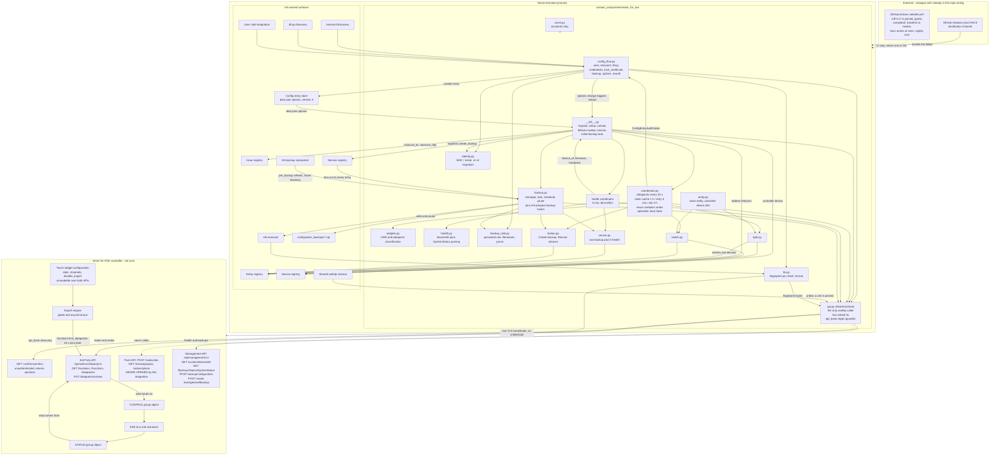
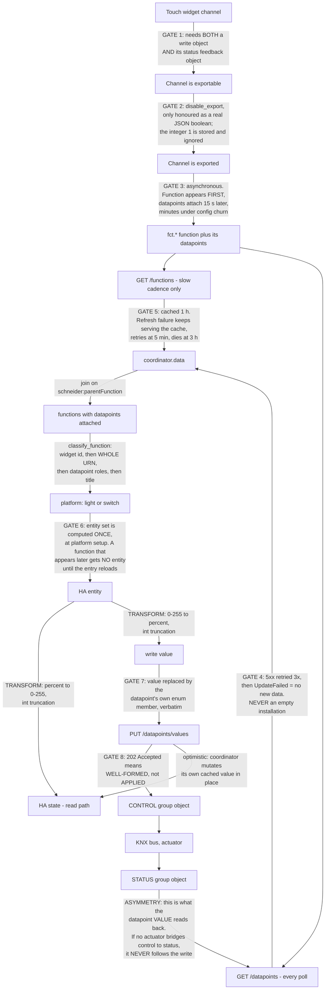

# Architecture

Diagram current as of 62fcfb6009758b2c8edc9f4d1c8d90818eb99a17 — 2026-11-20

Subject: the `wiser_for_knx` custom integration and the whole path between Home Assistant and
a Wiser for KNX controller — config flow and options, the coordinators, the API client, every
entity platform, the backup manager, and the KNX IoT 3rd Party API contract
(`schneider_knx_iot_3rdparty_v1_openapi.json`, [docs/controller-api.md](controller-api.md)).

Everything here is derived from the code, `manifest.json`, `hacs.json`, the CI workflow and the
measurement write-ups already in this repo and in
[wiser-knx-skillset](https://github.com/bartosekpetr/wiser-knx-skillset). No live controller was
touched to produce it. Confidence per edge is in [§8](#8-confidence).

The single most important thing on this page: **the integration owns almost nothing of what a
user sees.** Which devices exist, which channels are exported, what a value means and whether a
write has any effect are all controller-side decisions. Most "integration bugs" are the
controller answering honestly. [§7](#7-failure-attribution) is the table for that.

---

## 1. Master diagram — ASCII

```
  EXTERNAL - can change with nobody in this repo acting
  +----------------------+  +----------------------------+  +---------------------------+
  | GitHub releases      |  | GitHub Actions             |  | Wiser Touch widget config |
  | + HACS               |  | .github/workflows/         |  | slots / channels /        |
  | distribution channel |  | validate.yml  (CI only)    |  | disable_export            |
  |                      |  | ruff==0.17.3, pytest,      |  | the real source of truth, |
  |                      |  | compileall, hassfest@master|  | NOT readable over either  |
  |                      |  | hacs/action@main, nightly  |  | API                       |
  +----------+-----------+  +----------------------------+  +------------+--------------+
        (1)  | installs custom_components/wiser_for_knx               (2)| gates export
             v                                                           |
 +============================ HOME ASSISTANT PROCESS =====================|===========+
 |                                                                        |           |
 |  HA-OWNED SURFACES                                                     |           |
 |  zeroconf (3)   dhcp (4)   user "Add integration" (5)                  |           |
 |  config entry store: data + options (6,7,8)   entity registry (11,12)  |           |
 |  device registry (10,11)   issue registry (13)   service registry (14) |           |
 |  HA backup subsystem (16)  HA executor (18,21)  shared aiohttp session (20)        |
 |  reauth trigger (9)        <config>/wiser_backups/ (17)                |           |
 |      |                                                                 |           |
 |      v                                                                 |           |
 |  +-------------------------+                 +---------------------------+         |
 |  |     config_flow.py      |  (6) creates    |        __init__.py        |         |
 |  | user|zeroconf|dhcp ->   |---------------->| migrate v1->v2->v3 (7)    |         |
 |  | credentials ->          |  entry, then    | setup / unload / remove   |         |
 |  | [trust_certificate] ->  |  (8) reload     | leftover-entity sweep (12)|         |
 |  | backup -> entry         |<----------------| create_backup svc (14,15) |         |
 |  | options flow, reauth (9)|                 | initial-backup task       |         |
 |  +-----------+-------------+                 +--+------+--------+--------+         |
 |        (30)  | uses tls, identity,       (23)|  (24)|   (25)|   (22)|              |
 |              | backup_utils, api            |      |        |       |              |
 |              |                              v      v        v       |              |
 |              |       +-----------------------+  +---------+  +-----------+         |
 |              |       |    coordinator.py     |  | health  |  | backup.py |         |
 |              |       | WiserKnxDataUpdate-   |  | coordi- |  | manager + |         |
 |              |       | Coordinator           |  | nator   |  | HA pre/   |         |
 |              |       | datapoints every 10 s |  | 5 min   |  | post hooks|         |
 |              |       | static cache 1 h,     |  | poll,   |  | lock,     |         |
 |              |       |   retry 5 min,        |  | best    |  | schedule, |         |
 |              |       |   give up at 3 h      |  | effort  |  | prune     |         |
 |              |       | enum-verbatim writes  |  +----+----+  +--+-----+--+         |
 |              |       | optimistic local state|  (28)|        (37)|  (17)|          |
 |              |       +--+-----------------+--+       v            |      v          |
 |              |     (27)|                 |     +----------+       |  <config>/      |
 |              |          v                |     | health.py|       |  wiser_backups  |
 |              |     +-----------+          |     | parse    |       |  /*.zip        |
 |              |     | widgets.py|          |     +----------+       |  (18 executor) |
 |              |     | classify  |          |                        |                |
 |              |     +-----------+          |(32,33,34,35,36)        |                |
 |              |                   +--------+----+--------+------+   |                |
 |              |                   v             v        v      v   |                |
 |              |              light.py     switch.py  sensor.py  button.py            |
 |              |                   \            |        |        /   |               |
 |              |                    +-----------+--------+-------+    |               |
 |              |                                |                     |               |
 |              |                     entity.py base entity (36)       |               |
 |              |                     -> entity + device registries    |               |
 |              |                                                      |               |
 |              +-------------------------+----------------------------+               |
 |                                        v                                            |
 |                          +----------------------------+     +------------------+    |
 |                          |          api.py            |(38) |     tls.py       |    |
 |                          | WiserKnxClient             |<----| normalize/format |    |
 |                          | the ONLY aiohttp caller    |     | fingerprint,     |    |
 |                          | 5xx retried 3x (0.5s,1.0s) |     | fetch cert (21)  |    |
 |                          | api_base regex-guarded     |     +--------+---------+    |
 |                          | TLS mode fixed per client  |              |              |
 |                          +------------+---------------+              |              |
 |                                       | (40..48)                     | (49)         |
 |   const.py (39) supplies every constant above; identity.py (31) the stable ids;     |
 |   backup_utils.py (37) the pure password / filename / prune helpers                 |
 +=======================================|==============================|=============+
                                         |     TRUST / OWNERSHIP BOUNDARY
                                         |     HTTPS:443, HTTP Basic (admin),
                                         |     self-signed cert pinned by SHA-256
 +=======================================v==============================v=============+
 |                       WISER FOR KNX CONTROLLER  (not ours)                          |
 |                                                                                     |
 |  GET /.well-known/knx (40)  unauthenticated, returns api.base                       |
 |                                                                                     |
 |  3rd Party API  /api/w4knx/3rdparty/v1                                              |
 |    GET /locations            (41)  also the authentication probe                    |
 |    GET /functions            (42)  meta["@type"] = fct.* URNs -> platform           |
 |    GET /datapoints           (43)  THE WHOLE ENTITY GRAPH, one request              |
 |    PUT /datapoints/values    (44)  answers 202 Accepted before deciding             |
 |    NOT USED (53): POST /subscribe, GET /messaging/ws, /subscriptions/*,             |
 |                   /sites, /node, /devices, /installations, bulk + project writes,   |
 |                   PUT /functions|locations/attributes                               |
 |                                                                                     |
 |  Management API  /api/management/v1                                                 |
 |    GET  /custom/deviceInfo                  (45)  firmware, hardware, MAC/serial    |
 |    GET  /flashsys/Status/SystemStatus       (46)  uptime, load, memory, partitions  |
 |    POST /flashsys/system/backupConfiguration(47)  system ZIP, ~5 KB                 |
 |    POST /scada-main/general/backup          (48)  project ZIP, ~1.8 MB              |
 |    NOT USED on purpose: restore, admin password, hostname, KNX/BACnet patches, logs |
 |                                                                                     |
 |                         ^                                ^                          |
 |                         |                           (50) | export engine, gated by  |
 |                         |                                | write-object + status    |
 |                         |                                | slot pair AND by         |
 |                         |                                | disable_export, and      |
 |                         |                                | ASYNCHRONOUS (>= 15 s)   |
 |                         |                        +-------+--------+                 |
 |                         +------------------------| Touch widget   |                 |
 |                                                  | configuration  |                 |
 |                                                  +----------------+                 |
 |                                                                                     |
 |   datapoint write --(51)--> CONTROL group object --> KNX bus --> actuator            |
 |   datapoint value <--(52)-- STATUS  group object <-- actuator <-- KNX bus            |
 |   ^ the same single datapoint. Read slot and write slot are different objects.       |
 +=====================================================================================+
```

### Every edge, with direction

| # | From | To | Direction / carries |
|---|---|---|---|
| 1 | GitHub release + HACS | user's `custom_components/` | one-way, out-of-band install/update |
| 2 | Touch widget config | controller export engine | one-way; decides what the API publishes |
| 3 | HA zeroconf | `config_flow.async_step_zeroconf` | push; IP, hostname, port, properties |
| 4 | HA dhcp | `config_flow.async_step_dhcp` | push; IP + MAC (OUI-matched) |
| 5 | User | `config_flow.async_step_user` | push; manual host/port/credentials |
| 6 | `config_flow` | config entry store | write, once per flow (`data` + `options`) |
| 7 | config entry store | `__init__.async_migrate_entry` | read+write; v1→v2→v3 |
| 8 | options flow | config entry store → `async_reload_entry` | write, then full entry reload |
| 9 | `ConfigEntryAuthFailed` | HA reauth → `config_flow.async_step_reauth` | one-way signal out of the coordinator |
| 10 | `__init__` | device registry | write; the controller device |
| 11 | entity platforms | entity + device registries | write; one device per function |
| 12 | `__init__._remove_unsupported_entities` | entity registry | **delete**, every setup |
| 13 | `__init__._sync_transport_issues` / `async_remove_entry` | issue registry | create/delete repair issues |
| 14 | `__init__` | service registry | register/remove `wiser_for_knx.create_backup` |
| 15 | service call | **every** loaded entry's backup manager | fan-out, no target selector |
| 16 | HA backup subsystem | `backup.async_pre_backup` / `async_post_backup` | pull; never blocked by failure |
| 17 | backup manager | `<config>/wiser_backups/*.zip` | write (temp+rename) and **unlink** on prune |
| 18 | backup manager | HA executor | blocking filesystem work off the loop |
| 19 | `async_track_time_interval` | `backup manager._scheduled_backup` | timer, every `backup_interval_hours` |
| 20 | HA shared aiohttp session | `api.WiserKnxClient` | injected; **not** used in pinned-cert mode |
| 21 | HA executor | `tls._fetch_fingerprint` | blocking socket off the loop |
| 22 | `__init__` | `api.WiserKnxClient` | constructs it; owns its lifetime |
| 23 | `__init__` | `coordinator` | constructs + `async_config_entry_first_refresh` |
| 24 | `__init__` | health coordinator | constructs + `async_refresh` (best effort) |
| 25 | `__init__` | backup manager | constructs + `async_start` |
| 26 | `api` | `coordinator` | locations, functions, datapoints |
| 27 | `coordinator` | `widgets.classify_function` | pure call, per function |
| 28 | health coordinator | `api.async_get_health` → `health.parse_health` | pull, every 5 min |
| 29 | health coordinator | `__init__` | `device_id` → entry `unique_id`; firmware/hw → device info |
| 30 | `config_flow` | `tls`, `identity`, `backup_utils`, `api` | probe, verify, validate |
| 31 | `__init__` | `identity.stable_id_from_legacy` | v1 unique-id migration |
| 32 | `light.py` / `switch.py` | `coordinator.data` (read), `async_write_datapoint` (write) | **different slots, see §4** |
| 33 | last-backup sensor | backup manager listener | push on every backup result |
| 34 | health sensors | health coordinator | pull from its last payload |
| 35 | buttons | backup manager / `coordinator.async_refresh_structure` | one-shot commands |
| 36 | `entity.py` | `coordinator.data`, `client.base_url` | name, area, availability, `configuration_url` |
| 37 | backup manager | `api.async_get_backup`, `backup_utils` | download, name, list, prune |
| 38 | `api` | `tls.fingerprint_bytes` | builds `aiohttp.Fingerprint` once |
| 39 | `const.py` | everything | constants only, no behaviour |
| 40 | `api` | `GET /.well-known/knx` | unauthenticated; returns `api.base` |
| 41 | `api` | `GET {api_base}/locations` | also the authentication probe |
| 42 | `api` | `GET {api_base}/functions` | slow cadence only |
| 43 | `api` | `GET {api_base}/datapoints` | every poll; the whole graph |
| 44 | `api` | `PUT {api_base}/datapoints/values` | write; 202 before deciding |
| 45 | `api` | `GET /api/management/v1/custom/deviceInfo` | identity + firmware |
| 46 | `api` | `GET /api/management/v1/flashsys/Status/SystemStatus` | health |
| 47 | `api` | `POST /api/management/v1/flashsys/system/backupConfiguration` | system ZIP |
| 48 | `api` | `POST /api/management/v1/scada-main/general/backup` | project ZIP |
| 49 | `tls._fetch_fingerprint` | raw TLS handshake on `host:port` | **second boundary crossing**, no aiohttp, no credentials |
| 50 | Touch config | 3rd Party API | gated and asynchronous; see §4 |
| 51 | datapoint write | CONTROL group object → KNX bus → actuator | write direction |
| 52 | STATUS group object | datapoint value | read direction; may never follow 51 |
| 53 | push API (`/subscribe`, `/messaging/ws`, `/subscriptions/*`) | — | **exists in the contract, never opened** |

---

## 2. Master diagram — Mermaid



---

## 3. Components and responsibilities

| Component | Owns | Does **not** own | If removed |
|---|---|---|---|
| `config_flow.py` | the only place credentials, transport mode and a certificate pin are decided; probe-before-prompt for discovery; options and reauth | any runtime polling or writing | integration cannot be added or reconfigured at all; existing entries keep working until an auth or certificate failure, which then has nowhere to go |
| `__init__.py` | entry lifecycle: migrate → client → coordinator → backup manager → health → device → service → platforms → leftover sweep → initial backup | deciding *what* the controller publishes | nothing loads |
| `api.py` (`WiserKnxClient`) | the single HTTP chokepoint for both controller APIs; the `Accept: application/vnd.api+json` header; 5xx retry; the exception taxonomy that decides reauth vs retry; `api_base` validation | interpreting values, classifying, or deciding entity state | everything controller-facing stops; `tls.py`'s cert read still works |
| `coordinator.py` | polling cadence, the locations/functions cache and its staleness policy, enum-verbatim writes, optimistic local state, and the auth/TLS → reauth escalation | HTTP, classification rules, backups | lights, switches and the Rescan button die. The backup *logic* is independent of it — but the manager and the health coordinator are **attached to** this object (`coordinator.backup_manager`, `coordinator.health`) and `hass.data[DOMAIN][entry_id]` *is* the coordinator, so every platform reaches them through it. Backups survive a failing coordinator; they would not survive deleting it |
| health coordinator | the five controller-health values, on an independent 5-minute cadence, best effort | the entity graph | five diagnostic sensors go away; entry still loads, and the entry would stop learning its MAC/serial-based `unique_id` |
| `widgets.py` | classification only: Touch widget id → KNX URN → datapoint roles → title, in that order. Still classifies cover/climate/sensor so they can be *skipped* correctly | which platforms exist | every function would fall to the default and no light/switch split would survive |
| `health.py` | parsing `deviceInfo` + `SystemStatus` into flat values | fetching them | health sensors go blank |
| `identity.py` | the stable entry `unique_id` (MAC, then serial) and the pre-0.7 id migration | entity or device ids — those are keyed on `entry_id` | entries would key on host/IP again and DHCP churn would duplicate them |
| `tls.py` | trust-on-first-use: read a certificate without trusting it, normalise and display the SHA-256 | deciding to trust (the user does) | self-signed controllers could only be used with verification off |
| `backup.py` | the lock, the schedule, atomic write, prune, `last_error`, and the HA pre/post-backup hooks | the controller's backup format or password rule | the project's main feature is gone; lights and switches are unaffected |
| `backup_utils.py` | the password rule, filenames, listing and pruning — pure, HA-free, unit-tested | any I/O decision | same as above |
| `entity.py` | naming, area suggestion, `via_device` nesting and the "no datapoints ⇒ unavailable" rule | state semantics | lights/switches lose their device grouping and availability honesty |
| `light.py` / `switch.py` | datapoint *selection* (type before title, units excluded) and the on/off/brightness mapping | the write actually taking effect | the only user-controllable entities disappear |
| `sensor.py` | the diagnostic **Last backup** sensor plus the five health sensors | anything derived from controller *functions* — those sensors were removed in v0.5.0 | diagnostics go away; `_SENSOR_SUFFIXES` in `__init__.py` would then delete nothing |
| `button.py` | **Create backup** and **Rescan devices**, both `EntityCategory.CONFIG` | scheduling | manual backup still available via the service; rescan has no replacement |
| `const.py` | every tunable and every KNX URN | behaviour | — |

### Explicitly not part of this system

- **No restore.** Backups are downloaded only. Recovery is a manual upload in the controller's own
  web UI with the backup password. There is no code path that can restore, and deliberately so.
- **No controller administration.** Admin password change, hostname/network changes, KNX and BACnet
  patches and log clearing all exist on the management API and are never called. (The BACnet
  settings contain a `Password` field — redact it if diagnostics are ever added.)
- **No push / subscription path.** `manifest.json` declares `iot_class: local_polling`. The spec
  offers `POST /subscribe`, `GET /messaging/ws` and the whole `/subscriptions/*` family; none is
  opened. All freshness comes from polling.
- **No platforms beyond button, light, switch, sensor.** `binary_sensor`, `cover` and `climate`
  were removed in v0.5.0, as were the sensors built from controller functions. `__init__.py`
  actively deletes leftovers of those.
- **No colour control.** RGB/RGBW and DALI functions classify as lights but only on/off and
  brightness are implemented.
- **No backup download from the HA UI, and no copying backups elsewhere** (e.g. `/media`).
- **No pagination.** Deliberate: `?offset=`/`?limit=` are ignored by this firmware.
- **No `title` writes.** `PUT /functions|locations/attributes` answers 405; renaming happens in HA.

---

## 4. The load-bearing data path

`GET /datapoints` is the load-bearing request: the entire entity graph is built from it, once per
`scan_interval`. Everything below is on that path or on the write path that mirrors it.



### Walked through, with the places the obvious model is wrong

1. **A channel is not a device, and a widget is not a device.** One Touch widget publishes 1..N
   functions, of possibly *different* types. A 6-gang light switch with all 18 slots filled gives
   **6** `fct.switchingLight` functions; `se-logic-thermostat` at full slots gives **25 functions
   and 48 datapoints**. All of them share one `schneider:widgetId`. So grouping is by
   `schneider:parentFunction` and every match is enumerated — stopping at the first match yields
   one plausible-looking entity while five channels silently go missing.

2. **A missing device is usually not a bug.** Three separate controller-side gates (above) can hide
   a correctly configured widget, and only one of them is visible in the function/datapoint graph.
   A channel with a write object but no status feedback is simply never exported, even where the
   Touch documentation calls the feedback optional.

3. **A function with no datapoints is a normal state, not an empty device.** `entity.py::available`
   returns False for it rather than reporting a confident "off" that ignores every command.

4. **A failed read is not an empty installation.** `/datapoints` and `/functions` answer 500
   intermittently — most often while the controller recomputes its export — and *permanently* while
   an `se-danfoss-thermostat` widget has its `object-device-status` slot populated. `api.py` retries
   5xx three times (0.5 s then 1.0 s); the coordinator then raises `UpdateFailed`, which makes
   entities unavailable and removes nothing. After 3 consecutive refusals the log names the Danfoss
   cause, because nothing in HA looks wrong.

5. **The structure is up to an hour stale by design.** Locations and functions are cached for
   `STATIC_REFRESH_INTERVAL` (1 h). Two things shorten that: a datapoint referencing a function or
   location id the cache has never seen triggers one extra refresh (de-duplicated through
   `_unresolved_refs`, so an orphan datapoint costs one refresh and not one per poll), and the
   **Rescan devices** button forces it. If refreshes fail the cache is still served, retried every
   5 minutes, and abandoned at 3 hours — at which point entities go unavailable rather than serving
   stale structure forever.

6. **Rescan does not create entities.** `light.py` and `switch.py` enumerate
   `coordinator.data["functions"]` exactly once, in `async_setup_entry`, and call
   `async_add_entities` once. Nothing listens for new functions. So a newly added KNX widget shows
   up in `coordinator.data` after a rescan but gets **no entity** until the config entry is
   reloaded (options change, HA restart, or a manual reload).

7. **Read slot ≠ write slot.** A widget's control and status objects collapse into **one**
   datapoint: its `value` is the status object, a write to it drives the control object. So both
   optimistic *and* pessimistic state are wrong in general — where an actuator bridges control to
   status the value follows shortly, where nothing does (a lone KNX output) it never follows. The
   integration therefore updates its own cached value optimistically and **never** does
   write-then-verify-else-error.

8. **202 means well-formed, not applied.** A value that is not a member of the datapoint's `enum`
   *verbatim* is accepted and silently discarded: on the same writable switch datapoint `on`
   produces a telegram while `1` and `true` produce nothing. `coordinator._enum_member` maps the
   value onto the published spelling case-insensitively and logs a value that matches no member,
   because nothing else will report it. It reads the enum from the *last poll*, so a datapoint that
   was not in the last successful poll gets no enum mapping.

9. **Optimistic state works by reference sharing.** `async_write_datapoint` mutates
   `self.data["datapoints"][id]["value"]` in place. Entities read through
   `function_data["datapoints"][dp_id]`, which is the *same dict object* — `_async_update_data`
   attaches datapoints by reference. The optimistic update is visible to entities only because of
   that aliasing; a defensive `deepcopy` anywhere in that assignment would silently break it.

10. **Values are already in engineering units.** A `dpt.scaling` raw 128 is published as `50` with
    `unit: "%"`. Re-deriving a percentage from 0–255 would be wrong by 2.55×, so the published
    percentage is used as a percentage throughout. The 0–255 conversion in `light.py` is purely
    HA-side, between HA's brightness scale and the controller's percent.

11. **That percent↔255 conversion is lossy in both directions, and truncating.**
    `int(brightness/255*100)` on write and `int(percent/100*255)` on read. Consequences, from the
    code: HA brightness 128 writes 50 % and reads back **127**; and HA brightness **1 or 2 truncate
    to 0 %**, so asking a dimmer for its lowest brightness turns it off. Neither is a controller
    behaviour.

12. **Datapoint selection is pass-ordered on purpose.** Units are excluded first (a socket's
    read-only `dpt.power` in W and a dimmer's `%` brightness are measurements, never the on/off
    slot), then the datapoint *type* decides, then titles, then first-writable — in **separate
    passes**, so the controller's listing order cannot let a title-matched datapoint beat a
    type-matched one. Titles are user-defined KNX group-object names and cannot be trusted.
    A dimmer that publishes only brightness correctly has *no* switch datapoint; `is_on` and the
    turn on/off calls fall back to brightness.

13. **Match on the whole URN.** Vendor types exist
    (`urn:knx:fct.schneider.logicThermostat.type.thermostat`). Splitting on `.` and taking the last
    segment reads that as `thermostat`; taking the segment after `fct.` reads it as `schneider`.
    `widgets.py` substring-matches the full URN for exactly this reason.

### The backup path (the project's actual main feature)

```
trigger: schedule (every backup_interval_hours, default 24) | Create backup button
       | wiser_for_knx.create_backup service (fans out to EVERY loaded entry)
       | HA pre-backup hook | initial backup after setup (2 attempts, 60 s apart)
   |
   v  async with self._lock      <- serialises every trigger; no concurrent downloads
   v  configured?  -> password must pass the controller's rule (>=8, upper, lower, digit)
   |                  an empty/invalid password raises and backups are simply skipped
   v  POST backupConfiguration  -> system ZIP   (180 s timeout)
   v  POST scada-main/general/backup -> project ZIP
   |     400 => password rule violated; 401/403 => auth; empty body => raise
   v  executor: write <config>/wiser_backups/wiser_<host>_<kind>_<ts>.zip.tmp, rename
   v  prune: keep newest `backup_keep` (default 7) PER KIND and PER HOST
   v  last_backup / last_error / last_files -> listeners -> Last backup sensor
```

Asymmetries on it:

- **Pruning is keyed on the host string.** Filenames are `wiser_<safe_host>_<kind>_<ts>.zip` and
  `list_backups` filters on that prefix. If the controller's address changes (DHCP, or the user
  edits the host), the old files are no longer matched by any prune pass and accumulate forever.
- **The HA backup hook never blocks.** `async_pre_backup` catches `HomeAssistantError` and logs a
  warning, so an unreachable controller degrades the HA backup to "no fresh controller backup"
  rather than failing it.
- **The backup password is not the controller password.** It is stored in the entry *options*, and
  it is the only thing that can open the ZIPs. Losing it makes every stored backup unusable — there
  is no recovery path in this repo or in the controller.
- **The service has no target.** `wiser_for_knx.create_backup` iterates every loaded entry's
  manager, so on a multi-controller setup one call backs up all of them.

---

## 5. Per-component in / out

| Component | Reads | Publishes | Over |
|---|---|---|---|
| `config_flow.py` | discovery payloads; user form input; `/.well-known/knx`; `/locations`; `/custom/deviceInfo`; the peer certificate | a config entry (`data`: host, port, ssl, verify_ssl, username, password, api_base, certificate_fingerprint; `options`: backup_*), `DATA_INITIAL_BACKUP` | HA flow API; aiohttp; raw TLS socket |
| `__init__.py` | entry `data` + `options`; health payload | client, coordinators, backup manager, controller device, the `create_backup` service, repair issues, entity deletions | HA registries, `hass.data[DOMAIN][entry_id]` |
| `api.py` | both controller APIs | parsed dicts (locations, functions, datapoints), health dict, raw ZIP bytes, bool for a write | HTTPS + HTTP Basic |
| `coordinator.py` | `api` collections | `{"locations", "functions", "datapoints"}` plus `UpdateFailed` / `ConfigEntryAuthFailed` | `DataUpdateCoordinator` listeners |
| health coordinator | `api.async_get_health` | flat health dict | same |
| `widgets.py` | a function dict | one of `light`/`switch`/`cover`/`climate`/`sensor`/`binary_sensor`/`skip` | pure call |
| `health.py` | `deviceInfo`, `SystemStatus` | `device_id`, firmware, hardware, architecture, uptime, loads, memory %, storage % | pure call |
| `identity.py` | a controller info payload, or a legacy unique id | a normalised MAC or a serial | pure call |
| `tls.py` | a fingerprint string; the live peer certificate | normalised/displayable fingerprint, `aiohttp.Fingerprint` bytes | `ssl.get_server_certificate` in the executor |
| `backup.py` | options (password, interval, keep); existing files' mtimes; `api` ZIPs | ZIP files, `last_backup`/`last_error`/`last_files`, listener callbacks | filesystem, HA timer, HA backup hooks |
| `backup_utils.py` | a directory, a host, kinds, keep | validity bool, filenames, file lists, deletions | pure + `pathlib` |
| `entity.py` | `coordinator.data`, `client.base_url` | entity name, `device_info`, `suggested_area`, availability, extra attributes | HA entity API |
| `light.py` | the function's datapoints | `is_on`, `brightness`, `color_mode`; writes `on`/`off`/percent | coordinator |
| `switch.py` | the function's datapoints | `is_on`; writes `on`/`off` | coordinator |
| `sensor.py` | backup manager state; health coordinator | `Last backup` (timestamp + attributes) and 5 health sensors, all `DIAGNOSTIC` | HA entity API |
| `button.py` | — | two `CONFIG` buttons | coordinator / backup manager |

---

## 6. Change exposure

### Can change version or behaviour with nobody acting

| Thing | Why it moves | Blast radius |
|---|---|---|
| `hassfest@master` and `hacs/action@main` in `validate.yml` | **mutable refs**, re-resolved on every run, and there is a nightly `cron: "0 0 * * *"` | CI can start failing or start passing differently on an untouched repo. `actions/checkout`, `actions/setup-python` are SHA-pinned and `ruff==0.17.3` is version-pinned, so this is the only moving piece in CI |
| `pytest-homeassistant-custom-component==0.13.375` | pinned, but it pulls a **real** `homeassistant` transitively | see the next table row — this pin is what decides which code the suite exercises |
| `tests/conftest.py` mocking | it injects `homeassistant.*` mocks **only when `homeassistant` is not importable** | so CI (HA installed) and the documented local Windows setup (HA not installed) run *different code* from the same test files. "Tests pass locally" and "tests pass in CI" are not the same claim |
| Controller firmware | updated by the installer/user, out of band | the export gates, the 500 behaviour, `api.base` from `/.well-known/knx`, and the engineering-unit conversions are all firmware behaviour. Every measured fact in [docs/controller-api.md](controller-api.md) is pinned to firmware 3.1.0 |
| The Touch widget configuration | an installer edits a widget; nothing notifies HA | devices appear, change type, fan out or vanish. Nothing is exported until the gates pass, and nothing becomes an *entity* until the entry reloads |
| The controller's self-signed certificate | rotation, regeneration, expiry | a pinned fingerprint stops matching → `WiserKnxCertificateError` → `ConfigEntryAuthFailed` → reauth, which shows the old and new fingerprints and never re-trusts automatically |
| The controller's IP | DHCP | zeroconf/dhcp re-discovery updates the entry host when the stable `unique_id` matches. Already-written backup filenames keep the old host and fall out of pruning |
| HA core | users update it | min supported is `hacs.json`'s `2024.12.0`. Known pending cosmetic deprecation: `via_device` in `entity.py` should become `via_device_id` |
| HACS / GitHub releases | a published release is offered to every user | HACS only offers an update when tag, published release and `manifest.json` `version` agree |

`manifest.json` has `"requirements": []` — the integration itself pulls no Python dependency, so
there is no runtime dependency-bump exposure at all. Everything above is either CI or the
controller.

### Has no rollback

- **`_remove_unsupported_entities` deletes registry entries**, every setup, for any
  `binary_sensor`/`cover`/`climate` entity and any `sensor` whose unique id does not end in one of
  `_SENSOR_SUFFIXES`. Registry removal takes the entity's customisations with it (name, area,
  icon, hidden/disabled state). The practical trap: **adding a new sensor without adding its suffix
  to `_SENSOR_SUFFIXES` means it is deleted on every single setup.**
- **Pruning unlinks files.** `prune_backups` calls `Path.unlink`. Past the `keep` count per kind,
  the file is gone.
- **The backup password.** Lost ⇒ every stored ZIP is permanently unopenable.
- **Deleting and re-adding the integration re-keys everything.** Entity unique ids are
  `wiser_for_knx_<entry_id>_<function_id>` and device identifiers are `<entry_id>_<function_id>`,
  so a new entry means new unique ids: new registry entries, suffixed entity ids, and broken
  automations. The *entry* `unique_id` is stable (MAC/serial), but the entities are not keyed on it.
- **Config entry migration is forward-only.** `async_migrate_entry` returns `False` for
  `version > 3`, so an entry written by a newer version will not load on an older one.
- **A write that lands on the bus.** No undo, by nature. This is why there is no bulk-write or
  scene-firing surface here.

---

## 7. Failure attribution

| Symptom | Suspect first | Notes |
|---|---|---|
| **Every** entity unavailable at once, HA log shows `Error fetching data` | the controller, not the integration | `/datapoints` is 5xx-ing. After 3 consecutive refusals the log names the likely cause |
| …and it never recovers | a Touch **`se-danfoss-thermostat` (floor heating) widget with `object-device-status` populated** | makes `GET /datapoints` return 500 for as long as the widget exists; deleting it restores the endpoint immediately. 37 other widget types declare the same slot and are all harmless — it is the combination |
| Entry fails to set up, retries with backoff | `ConfigEntryNotReady` from the first refresh | a 5xx or an unreachable controller at startup. Correct behaviour, not a fault |
| HA asks to re-authenticate | `ConfigEntryAuthFailed` | either 401/403 (credentials changed on the controller) **or** a certificate that no longer matches the pin. The reauth flow distinguishes them |
| One device shows **Unavailable** while the rest are fine | **not a fault** | the function is published but its datapoints have not attached yet — 15 s typically, minutes during config churn. Recovers on a later poll. `fct.content` (Content widget) legitimately never has any |
| A widget configured in Touch has no HA device at all | the controller's export gates | needs **both** a write object and its status feedback; and `disable_export` suppresses export when stored as a real boolean (stored as the integer `1` it is ignored, so it *looks* set and is not). Neither is visible in the function/datapoint graph |
| A new widget appears in the API but gets no entity | **the integration** — gate 6 | the entity set is built once at platform setup. Rescan refreshes data only. Reload the config entry |
| A 6-gang switch shows one entity instead of six | the integration, if it ever stops enumerating | channel fan-out is 1:N; grouping must be by `schneider:parentFunction`, never by widget id, and must not stop at the first match |
| A command does nothing, HA shows the new state anyway | the controller accepted and discarded it | 202 ≠ applied. Check the log for the `accepts only …` warning from `_enum_member`; if it is absent the value matched the enum and the write did reach the bus |
| A command reaches the bus but the entity snaps back on the next poll | **not a fault** | the datapoint value is the *status* object. If no actuator bridges control → status, it will never follow. Optimistic state is the only honest option |
| Brightness comes back one or two steps off what was set | the integration's percent↔255 truncation | HA 128 → 50 % → 127. HA 1–2 → 0 % → off |
| Device names or rooms are wrong / stale | the Touch config, then the 1 h cache | `PUT /functions\|locations/attributes` answers 405, so the API `title` is an initial value only; rename in HA. `/locations` is flat with every `type: null`, so the room name is used directly as the suggested area and no floor hierarchy exists |
| A device moves to a different area after a restart | the flat `/locations` list | `suggested_area` is re-derived from `schneider:parentLocationName` each time the device is created |
| Entities vanished after an upgrade | `_remove_unsupported_entities` | intentional for `binary_sensor`/`cover`/`climate` and function-derived sensors (removed in v0.5.0). Unintentional if a *new* sensor's suffix was not added to `_SENSOR_SUFFIXES` |
| No backup files appear, no error anywhere | no valid backup password | an empty or rule-violating password makes `configured` False and backups are skipped silently by design. Set it in **Configure** |
| Backup fails with HTTP 400 | the password rule | ≥ 8 chars with an upper-case letter, a lower-case letter and a digit, enforced by the controller |
| Backup fails with HTTP 404 on the *initial* automatic backup while the button works | open, seen once | v0.5.1 names the failing endpoint and retries once after 60 s. Check the log if it recurs |
| Old backups never get cleaned up | the host string changed | pruning matches on `wiser_<safe_host>_`; files from a previous address are orphaned |
| An HA backup succeeded but contains a stale controller backup | the controller was unreachable at pre-backup time | by design: a warning is logged and the HA backup is never blocked |
| Health sensors are blank, everything else works | the management API | the health coordinator is best effort — a failure there never blocks setup |
| The entry has no `unique_id` | the management API was unreachable at setup | a legacy IP-based id cannot be converted offline, so it is cleared and re-learned from `deviceInfo` or from discovery later |
| HTTP 406 from the 3rd-party API | the `Accept` header | must be `application/vnd.api+json, application/json`. Plain `application/json` is 406 — on the 3rd-party API only; the management API takes `application/json` |
| A repair issue about insecure transport | configuration, not a fault | `insecure_tls` (ssl on, verification off, no pin) and `insecure_http` (ssl off) are mutually exclusive and are re-synced on every setup |
| Reads are slow / the controller is loaded | collection size | collections are never paged, so every poll transfers the whole datapoint set. `se-logic-thermostat` at full slots alone is 25 functions / 48 datapoints |
| Tests pass locally but fail in CI (or the reverse) | the conftest mock/real divergence | mocks are injected only when `homeassistant` is not importable |

---

## 8. Confidence

### Edges

| Edge | Confidence | Basis |
|---|---|---|
| `GET /locations`, `/functions`, `/datapoints` shapes and fields | **measured** | real-controller dumps via `tools/dump_controller.py`; unit tests use real URNs and datapoint types |
| `PUT /datapoints/values` → 202, and 202 ≠ applied | **measured** | enum-verbatim probing: `on` produced a telegram, `1`/`true` produced nothing |
| Control/status collapse into one datapoint | **measured** | writing an `se-ac-switch` status datapoint emitted a `groupwrite` to `object-1` |
| `dpt.scaling` published as percent (raw 128 → `50`) | **measured** | written both ways round on the same object |
| `Accept: application/json` → 406 on the 3rd-party API | **measured** | probed |
| Collections ignore `?offset=`/`?limit=` | **measured** | `items == total` on every request |
| Export needs write object **and** status feedback | **measured** | a test layout built with channels deliberately incomplete, compared against the dump |
| `disable_export` is a real second gate, boolean-only | **measured** | written both as `true` and as `1`, then read back |
| Function published before its datapoints (~15 s, longer under churn) | **measured** | `se-alarm-water`, `se-light-dimmer-rotary`, `se-thermostat-vdc`, re-measured on a quiet controller |
| Channel fan-out 1:N; `se-logic-thermostat` → 25 functions / 48 datapoints | **measured** | full-slot sweep |
| `se-danfoss-thermostat` + `object-device-status` wedges `/datapoints` | **measured** | bisected one slot at a time; 37 other types with the same slot are harmless |
| Intermittent 5xx on `/datapoints` / `/functions` | **measured** | observed repeatedly during export recomputation |
| Datapoint and function ids stable across widget edits and renames | **measured** | ids byte-identical across edits; API `title` follows the rename |
| `PUT /functions\|locations/attributes` → 405 | **measured** | probed |
| `/locations` is flat, every `type: null` | **measured** | dumps |
| Both management backup endpoints return a password-protected ZIP | **measured** | `tools/probe_management.py`, and end-to-end in a real HA |
| Backup password rule | **measured** | controller returns 400 below it |
| `/custom/deviceInfo`, `/flashsys/Status/SystemStatus` field names | **measured** | management-API probe; `health.py` parses the real payloads |
| Light/switch control end to end, including the 202 | **measured** | real HA against a real controller |
| `/.well-known/knx` returns an `api.base` | **observed-only** | the probe works; a controller actually *moving* its base has never been seen, and the regex guard has only been unit-tested |
| HTTP 404 from a backup endpoint on the initial automatic backup | **observed-only** | seen exactly once; the button worked at the same time. Cause unknown |
| `fct.se8000` F→C conversion on `dpt.valueTemp` | **measured**, but **not on this integration's path** | verified against an `se-thermostat` on the same group address. Only matters if climate returns |
| `fct.gasSensor` concentrations (factor of 1000) | **observed-only, unexplained** | `se-air-quality` `no2`/`ozone` published `0.0215` for a raw 21.5. Sensors from functions are not imported, so it is off-path |
| zeroconf matchers (`wiser*`, `spacelynk*`, `logicmachine*` on `_http._tcp`) | **inferred** | from `manifest.json`; the probe-before-prompt guard exists precisely because the match is a guess |
| DHCP OUI matchers (`000CC6*`, `000054*`, `E04F43*`) | **inferred** | vendor ranges; they cover far more than controllers, hence the probe |
| The whole push/subscription path | **inferred from the spec only** | `POST /subscribe`, `GET /messaging/ws`, `/subscriptions/*` are in `schneider_knx_iot_3rdparty_v1_openapi.json` and **never opened**. The skillset notes subscriptions also deliver two built-in automation-trigger virtuals, which would need filtering — untested here |
| Every other spec path (`/sites`, `/node`, `/devices`, `/installations`, bulk and project writes, `POST`/`PUT /locations`) | **inferred from the spec only** | never called by this integration, never probed |
| Everything HA-runtime: flow steps, registries, scheduler, services, backup hooks, migration | **inferred from code** | `tests/conftest.py` mocks HA when it is not installed, so these are reasoned from the code and from the manual checklist in [docs/development.md](development.md), not asserted by the suite in every environment |

### Never probed

- The push/subscription path, end to end. If it is ever adopted, `iot_class` changes from
  `local_polling` and gates 5 and 6 above change shape entirely.
- Restore. Deliberately out of scope; the download side is the only half that was measured.
- Multi-controller setups. The code supports them (`hass.data[DOMAIN]` is keyed by `entry_id`,
  pruning and filenames are per host, the service fans out), but nothing in the repo records this
  being run against two controllers at once.
- A controller actually moving its `api.base`, or presenting a changed certificate mid-life. Both
  code paths exist and are unit-tested; neither has been exercised against real hardware.
- Behaviour on any firmware other than 3.1.0 (`i.MX6UL LM2i`).
- Anything about `/datapoints` response time or memory at installation sizes larger than the dumps
  in hand. Collections are unpageable, so this is the scaling limit if one is ever hit.

---

## 9. Keeping this page honest

Every revision records `Diagram current as of <sha> — <date>` at the top. The next run diffs that
sha against `HEAD` and only re-revises if the components, their responsibilities, or how data moves
between them actually changed. Dependency bumps, test-only changes, copy edits and release notes
are not changes to this diagram.

Both Mermaid blocks on this page are validated by parsing them with `mermaid.parse`, not by eye.
